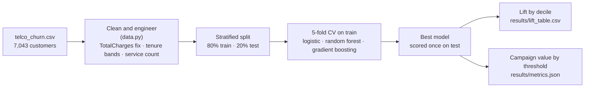
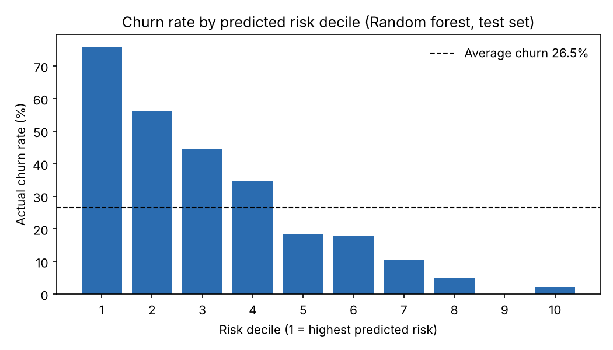
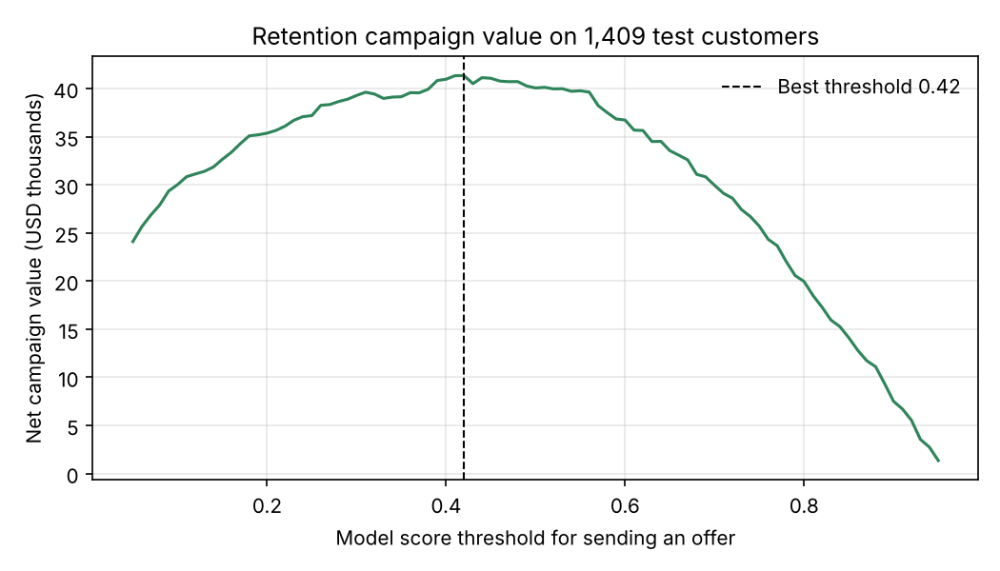

<div align="center">

# Telco Customer Churn: Prediction and Retention Targeting

**A churn model for 7,043 telecom customers that ranks who is most likely to leave, and a simple campaign model that turns those scores into a decision about who should receive a retention offer.**

[](https://github.com/Collinsthe4th/telco-customer-churn/actions/workflows/ci.yml)
[](https://www.python.org/)
[](https://scikit-learn.org/)

</div>

---

## Contents

- [About the project](#about-the-project)
- [Pipeline](#pipeline)
- [Tech stack](#tech-stack)
- [Results](#results)
- [Interactive dashboard](#interactive-dashboard)
- [Getting started](#getting-started)
- [Project structure](#project-structure)
- [Limitations](#limitations)

## About the project

Keeping a customer is usually much cheaper than winning a new one, so a telecom provider wants to know who is about to cancel while there is still time to do something. The data is the IBM Telco Customer Churn sample. It describes 7,043 customers with their contract, services, billing and tenure (months as a customer), and whether they left in the last month. Overall 26.5% of them churned (cancelled).

A churn model on its own does not tell the business what to do. So I added a second step. Given a model score, a cost per retention offer and a value per saved customer, which customers should get an offer?

## Pipeline



The steps are listed below.

1. **Cleaning.** `TotalCharges` is stored as text and is blank for 11 customers with a tenure of 0. They have not been billed yet, so I set their total to 0 and did not drop them.
2. **Feature engineering.** I added the average monthly spend, the number of add-on services and a tenure band (0 to 6 months, 7 to 12 months, and so on).
3. **Model selection.** I compared three models with 5-fold cross-validation on the training set only. The test set (1,409 customers) was used once, for the final numbers.
4. **Campaign sizing.** I assumed that a saved customer is worth 12 months of their bill (769.07 dollars on average), that one offer costs 50 dollars, and that 30% of the churners who get an offer will stay. These numbers are my assumptions, not facts from the data, and they can be changed at the top of `scripts/train.py`.

## Tech stack

| Area | Tools |
|---|---|
| Data handling | pandas, NumPy |
| Modelling | scikit-learn pipelines (`ColumnTransformer`, one-hot encoding, scaling) |
| Models | logistic regression, random forest, histogram gradient boosting |
| Evaluation | stratified cross-validation, ROC-AUC, PR-AUC, lift by decile |
| Testing | pytest, GitHub Actions |

## Results

| Model | Cross-validated ROC-AUC |
|---|---|
| Majority class (baseline) | 0.5000 |
| Logistic regression | 0.8472 ± 0.0109 |
| **Random forest** | **0.8474 ± 0.0107** |
| Gradient boosting | 0.8411 ± 0.0080 |

Table 1- ROC-AUC (how well the model ranks churners above loyal customers) over 5 folds of the training set.

The random forest and the logistic regression scored almost exactly the same, with a difference of 0.0002, which is far smaller than the spread between folds. This means that the simpler logistic regression would be an equally good choice in production. On the test set, the random forest reached a ROC-AUC of 0.845 and caught 78.3% of the churners at the default threshold of 0.5 (precision of 53.2%).



Fig. 1- Actual churn rate in each tenth of the test customers, sorted by model score. Source: Collins Akagha (2026).

The model is most useful as a ranking. The 10% of customers with the highest scores churned at 75.9%, which is 2.86 times the average rate. The top 30% of customers held 66.6% of all churners. This shows that a retention team could reach two thirds of the people about to leave by calling less than a third of the customer base.



Fig. 2- Net value of the retention campaign at each score threshold, under the stated assumptions. Source: Collins Akagha (2026).

Under my assumptions, the best threshold was 0.42. Sending offers to the 636 test customers above it gave a net value of 41,338 dollars. Sending an offer to all 1,409 test customers gave only 15,839 dollars, because most of the money went on customers who were never going to leave.

The data also shows clear drivers. Customers on month-to-month contracts churned at 42.7%, against 11.3% on one-year contracts and 2.8% on two-year contracts. Customers in their first 6 months churned at 52.9%, against 9.5% for customers of more than 4 years.

## Interactive dashboard

The Streamlit app (`streamlit_app.py`) has three tabs. You can score a single customer, plan a retention campaign with your own assumptions for offer cost, save rate and customer value (the best threshold and net value update straight away), and see the main drivers of churn. The app uses the logistic regression, which tied with the random forest in cross-validation and loads much faster.

```bash
streamlit run streamlit_app.py
```

## Getting started

```bash
git clone https://github.com/Collinsthe4th/telco-customer-churn.git
cd telco-customer-churn
python -m venv .venv && source .venv/bin/activate   # Windows: .venv\Scripts\activate
pip install -r requirements.txt

python scripts/train.py      # CV, test scores, lift table, campaign value, figures, saved model
python -m pytest -q
```

The data file is included in `data/raw/`. It is the [IBM Telco Customer Churn](https://www.kaggle.com/datasets/blastchar/telco-customer-churn) sample from Kaggle.

## Project structure

```
telco-customer-churn/
├── data/raw/telco_churn.csv
├── src/telco_churn/
│   ├── data.py        # cleaning and feature engineering
│   └── models.py      # pipelines, metrics, lift table, campaign value
├── scripts/train.py   # model selection, test evaluation, figures
├── results/           # metrics.json, lift_table.csv, figures/
└── tests/             # pytest unit tests
```

## Limitations

The best threshold of 0.42 was chosen on the same test set that reports its value, so the 41,338 dollar figure is slightly optimistic. A cleaner approach would pick the threshold on a separate validation set. The campaign numbers also depend completely on my three assumptions, and the real save rate can only be measured with an experiment (for example, an A/B test where half of the high-risk customers get the offer). Finally, the data is a single snapshot, so the model cannot see changes in behaviour over time.

In conclusion, the model ranks customers well enough (ROC-AUC 0.845, top-decile lift of 2.86) to focus a retention budget, and the campaign step shows that targeting by score is worth about 2.6 times as much as giving everyone an offer.
